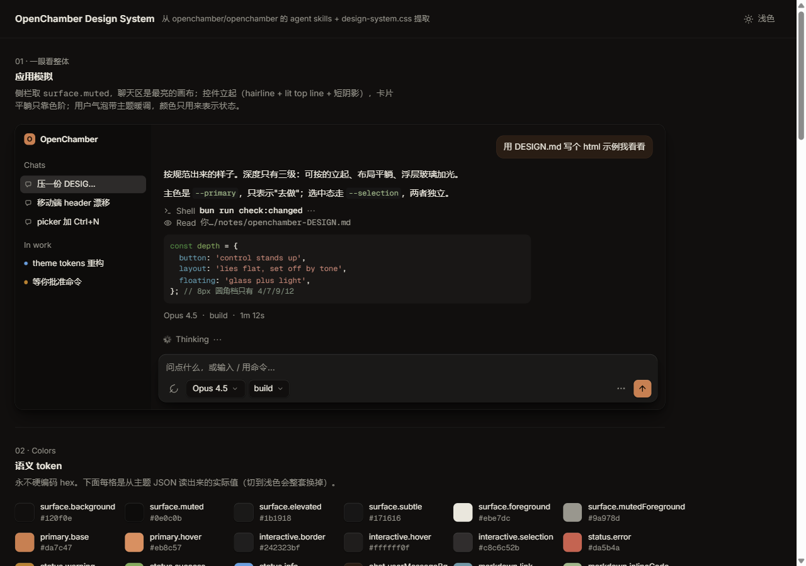

# OpenChamber Design System — 提取版规范

> **非官方。** 这套设计语言属于 [openchamber](https://github.com/openchamber/openchamber)（MIT，约 13k ★）。
> 本仓库把它散落在 agent skills、`design-system.css` 和 60 多个主题 JSON 里的规范，整理成一份可投放的
> `DESIGN.md`，外加两个能直接双击打开的 demo。



## 它解决什么问题

给 coding agent 讲设计，最省事的做法是丢一份 `DESIGN.md`：结构化 token + 散文理由。openchamber 的规范质量很高
（它连"为什么浅色主题里 elevated 比画布更深、所以输入框是压进页面的"都写在注释里），但形式是 agent skills +
48KB CSS + 主题 JSON，人和工具都不好直接吃。

所以这里做了三件事：

1. **合并** —— 把五份 skill、样式源码和主题 JSON 压成一份 `DESIGN.md`（YAML tokens + 七节散文）。
2. **补实测** —— 附录里是从源码 Tailwind/cva 类读出来的组件尺寸表（按钮、触发器、输入框、分段选择、步进器、
   设置页节奏），不是从截图量的。
3. **可视** —— 两个 demo 页面把每条规范摆出来：应用模拟、色板、字号尺、控件、三级深度、设置面板复刻。

## 目录

```
DESIGN.md                 ← 规范本体（YAML tokens + 散文 + 源码级规格附录）
tokens/                   ← 4 个主题 JSON，原样取自 openchamber
  openchamber-dark.json     品牌主题（暖黑底 + 橙铜主色）
  openchamber-light.json
  vercel-dark.json          Vercel 调色板（纯黑 + 蓝主色）
  vercel-light.json
demo/
  openchamber.html        ← 品牌主题 demo（右上角切深/浅）
  vercel.html             ← 同一套布局，只换 token
  assets/fonts.css        ← Inter + Geist Mono（latin 子集，woff2 内嵌，断网可用）
docs/                     ← README 用的预览图
scripts/verify.mjs        ← 无依赖自检
licenses/                 ← 两个字体的 OFL 1.1 原文
```

## 看

直接双击 `demo/openchamber.html`（`file://` 就能跑，字体已内嵌，不联网）。右上角切浅色/深色——规范里那条
"两套主题都要看过"就是这个按钮。

`demo/vercel.html` 是同一份 HTML，只把开头两个 token 块换成 `tokens/vercel-*.json` 的值。对比着看能发现一件事：
Vercel 深色的 `surface.elevated`（`#070707`）几乎贴着纯黑画布，于是"选中项回到 elevated"这条规则在那里只能靠
一圈边分辨——这是配色的锅，不是组件的锅。

## 验

```bash
node scripts/verify.mjs
```

27 条断言：文件齐备、`DESIGN.md` frontmatter 可解析、4 个主题 JSON 结构完整、两个 demo 双主题与组件齐备、
没有远程资源、字体确实内嵌、**仓库里没有本机路径**。退出码非 0 即失败。

## 三条设计原则

1. **安静优先。** 静止的屏幕只显示用户要读的内容和需要用户的东西，其余等 hover、菜单或快捷键。
2. **控件立起，布局平躺。** 深度只有三级（button / raised / floating），卡片和分组没有边框，只靠色阶区分；
   每一级都是玻璃边压在半像素上——一条 hairline ring + 一条受光的顶线，深色主题在亮环外再加一圈暗环。
3. **颜色只表示状态。** 蓝=正在工作，绿=已完成/待读，黄=等用户，红=错误；非状态的强调一律用 muted 或正文色。

## 速查

| 项 | 值 |
|---|---|
| 圆角 | 4 / **7** / 9 / 12 / full（控件几乎都是 7，tile 内小块 9，浮层与模态 12） |
| 字号 | 正文 14、区块 15、标签 13.5、meta 12.5、micro 12、代码 12 |
| 按钮 | 32 / 28 / 24 / 36（default / sm / xs / lg），圆角 7，13.5px 500 |
| 下拉触发器 | 28px / r7 / 横向 10px |
| 输入框 | 32px / r7 / elevated 底 + hairline |
| 分段选择 | 轨道 r9 + 2px 内距/间距 + `fg 4%`，选项 28px / r7 / 400 |
| 步进器 | 32px / r9 / ± 各 36px + 内侧分隔线 |
| 设置页 | 列间距 40、行间距 24、字段 16、标签到控件 8 |
| 深度 | button（可按）/ raised（布局里的面）/ floating（浮在上面） |
| 动效 | 弹簧编译成 `linear()`：弹层 251ms、布局 294ms、关闭 110ms |

完整版见 `DESIGN.md`。

## 用到自己项目

- **只要配色**：拿 `tokens/*.json`，九个语义家族（primary / surface / interactive / status / syntax / pr / chat /
  markdown / tools）直接映射成 CSS 变量。
- **要整份规范**：把 `DESIGN.md` 放进仓库根目录，Claude Code / Cursor / Codex 都会读；它比一页提示词管用。
- **要组件视觉**：`demo/*.html` 开头那一段 `:root` token 块 + `.btn` / `.field` / `.trigger` / `.seg` / `.stepper`
  的规则可以整段搬走——它们就是按附录里的实测规格写的，不依赖任何框架。

## 来源与许可

- 本仓库内容：[MIT](LICENSE)。
- 设计语言与主题 JSON：[openchamber/openchamber](https://github.com/openchamber/openchamber)，MIT。
  本仓库是独立提取，**不是**官方文档，也不代表上游立场；上游改动后这份规范可能过时。
- 字体：Inter（SIL OFL 1.1，The Inter Project Authors）、Geist Mono（SIL OFL 1.1，Vercel），
  均为 latin 子集，原文见 `licenses/`。
- 格式参考：[google-labs-code/design.md](https://github.com/google-labs-code/design.md)。
